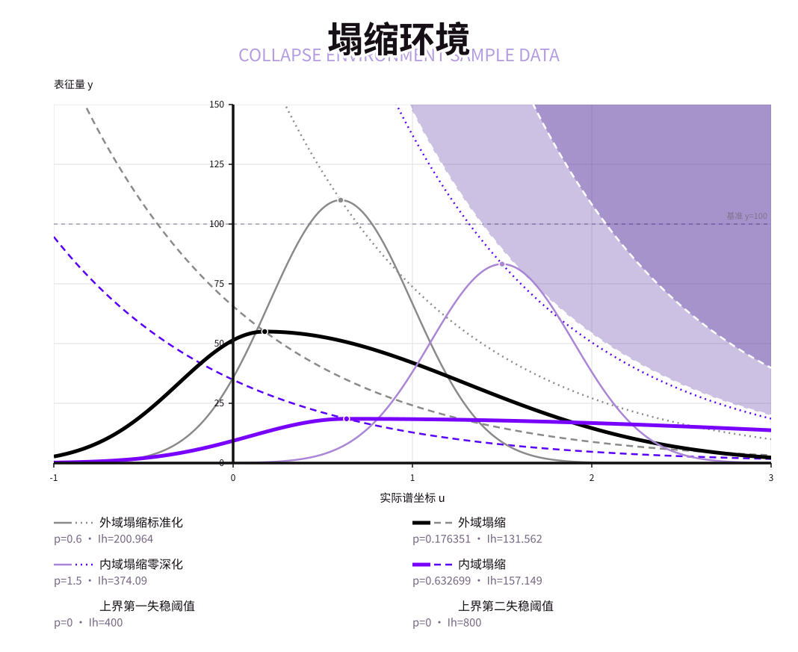
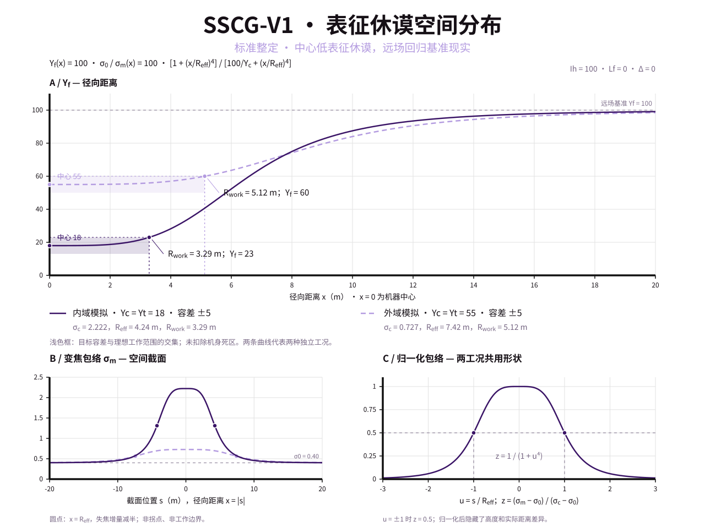

# 本体学与休谟学工具

或者叫`休谟工具`也可以，利用休谟概念辅助我们保护，理解以及改造世界。有一些工具与之交叉但更为强力，
它们很可能被[归入了`超形上学工具`内]()。

大部分此类工具在模块化设计上具有一定的相似性，只是在表现功能上可能有所差异。
因此，我们只会在`SRA`中详细介绍这些模块方向，后续则会直接引用。

## (类)现实稳定锚 `SRA`

现实稳定锚，在原设(SCP)中全称`斯克兰顿现实稳定锚(SRA)`，本设定中代指以`斯克兰顿扩散装置`为技术主体，
通过各种途径使得在机器工作的有效范围内控制现实波动(`表征休谟指数`波动)的装置。

`斯克兰顿扩散装置`的核心是实现了范围内休谟的可控精准变谱，从而对空间内的休谟进行填充或波动拒止。
在这一基础上，对于实际的处理方式，大致分为五个方向：

- 变焦（主要通过`变焦标准差σ`影响`表征休谟指数Yf`）: 通过改变区域范围内的`σ`来发散/聚集休谟，使其在`休谟主频Lf`处的`Yf`
  趋向于基准现实或期望的值。

    - 优点: 工作行为本身对外部能量供应的条件不苛刻，不消耗贵重或稀缺物质资源，有效反应周期极短，也不容易造成副作用，
      对聚焦类异常/行为(例如源石技艺施法)具有极高的抵抗力。
    - 缺点: 造价极其昂贵，需要精密高频休谟采样传感器，且工作状态下维持所需的能量成本极高(几种方案里最高的)，
      可能影响到其它`失焦收容`方案的稳定性。
    - 主要用途与定位: 应急快速休谟稳定，异常环境突击，源石技艺(部分)攻击防御，作为辅助兜底手段防止瞬间休谟波动过大导致的机器损毁。
    - 技术迭代路径: 待补充。

- 变频（主要通过`休谟主频Lf`影响`表征休谟指数Yf`）: 通过使`休谟主频Lf`滑动到更高/更低频率上来影响`Yf`。
    - 优点: 副作用低，在主频滑动倾向与目的一致的情况可以使用极低能量快速实现效果，速度较快且失效后还能自然维持一段时间，达到目标后的维持消耗极低。
      工作行为本身需要的物质资源可以从偏频空间中大量获得
      (在泰拉时期这些空间稀少故而有些困难，自从热脉实质化后几乎就不再是问题)。
    - 缺点：技术精密度要求高，在无倾向滑动状态下工作较慢，逆倾向时则速度极慢且消耗资源与能源急剧上升。
      在高/极低`Ih`环境下存在严重稳定性缺陷。
    - 主要用途与定位：不改变`Ih`情况下的较优解决方案，非紧急状态下休谟自均衡化处理中最佳的表征休谟钳制方案，
      或为可能且已知倾向的现实稳定装置失效提供弹性休谟余量。
    - 技术迭代路径：待补充。

- 拒止（通过引导休谟梯度扩散，又称`扩散围栏`（减速）或`扩散滑梯`（加速）。特指非实体型隔断。）
    - 标准现实稳定锚的第二结构
    - 优点：维持工作所需的能量很少，是降低`本征休谟`由于空间性流动导致休谟灌入/流失的最佳方法，
      也是真正处理由于`本征休谟`不平衡导致现实倒灌或逸散的方法。
      其工作原理上有点类似半透膜，可以一定程度阻止休谟向某个方向的流动。且造假低廉的版本也能提供不错的防护性。
    - 缺点：在极端休谟环境下表现不够好，高休谟环境下甚至有可能直接被冲爆；技术精进化迭代的研发边界效应明显，因此投入与产出的比值一直在呈下降趋势；
      无法主动逆转休谟平衡化趋势，只能加快或减慢休谟的内外平衡过程。
    - 主要用途与定位：休谟场维持，对已有基态现实进行缓冲保护，制造休谟波动实验的安全防护区等。最常用，因为适用于大部分非收容场景且成本低廉。
    - 其大致分外三个技术阶段：区域牵引，离散等效切变边界，连续切变边界。
    - 技术迭代路径：待补充。

- 消解（高低休谟对冲抵消）
    - 标准现实稳定锚的第一结构，原始设计无从得知，现有设计使用的均为休谟容器物质。
    - 优点：轮椅。使用高密度高/低休谟容器来在几乎不需要能量的情况下释放休谟调控环境，或是使用可充入容器消耗大量能量直接吸休谟。本体结构造价也足够低廉。
      稳定性很好，能面对各种休谟环境，实在爆了如果能把材料内休谟释放出来也能创造一定时间的较稳定的休谟域。
    - 缺点：高/低休谟容器本身很难获得，高效运行的材料成本极高。释放速度受稳定性影响通常不高。
    - 主要用途与定位：轻度`本征休谟`调整首选方案，所有高价值目标的必备保险方案，伴随足够的休谟容器储备。对于攻坚环境下也会使用。
      大部分锚内置该模块，但通常使用的是密度较低的休谟容器，所以能力上有所欠缺，不过能拿量顶。
    - 技术迭代路径：待补充。

- 泵送（逆`本征休谟`抽送）
    - 优点：可以改变空间的`本征休谟`量，且不需要消耗性的休谟容器，稳定性好，可以创造逆梯度环境，运行速度较快。
    - 缺点：制造本身极为昂贵且精密，运转能源消耗巨大，维护成本与时间消耗都很高，
      `本征休谟`梯度差越大效率越低，且需要有其它空间区域作为休谟载体/容器。
    - 主要用途与定位：重度`本征休谟`调整与逆梯度构造首选方案，需配置独立能源供应模块，并对可用的抽取源区域进行维护与监控。
    - 技术迭代路径：待补充。

- *深度方案：

  利用深度偏移来直接拉扯`Ih`其实也是一种方案，但需要消耗巨量的能量和珍贵材料，且涉及到深度的环境极不稳定，很容易出现严重的安全事故。
  因此，相关模块没有被大量推广。一般作为大范围杀伤性休谟武器/保险销毁装置使用，也被用于实验室制备特殊深度和含`φ子`物质。

大多数情况下几个方向的机制都在同时发挥作用，但其侧重点有所不同，其技术路径，产品成本，迭代规则也各有差异。

扩散装置除了以机械为中心进行范围稳定的“锚”之外，还存在一种通过聚焦对机械外有效距离内某一点/小范围进行休谟调控的机械，
形状类似信号接收器，拥有一个球冠状反射面，通常被称为“缆”，一些情况下也会被统称为“锚”，其二者在扩散原理上没有区别。

其小作用范围使其需要消耗的资源大幅减少，且对定点的稳定性与控制能力表现极强，常用于针对某个异常物收容的定向稳定。

## 切变壳层空化发生器 `SSCG`

Shear-Shell Cavitation Generator，简写`SSCG`，
又称 `科杰尔-朗(Kejel-Lang)空化腔`/`空化锚`/`倒锚` 。

`空化锚`是用于在现实区域中通过休谟状态的重新分配实现以较低成本创造`低休谟环境`的工具。
在早期，其主要通过改变`表征休谟`实现，后期则逐步转向真正的改变`本征休谟`。

与现实稳定锚最大的差别是，稳定锚通常使环境维持在基准现实水平，
而这一装置则更多负责使环境逆梯度偏移。相对而言，这使其更侧重于“变动”而非“维持”，速度与强度要求高于稳定性。

其原型由新乌萨斯`国家现实保卫委员会(CPR/КОД)`研发，作为用于模拟与研究`国度`环境的中间设备。

其大致的工作原理是：通过`散焦/滤谱`制造低`表征休谟`环境，通过控制区域不同位置的`表征休谟`强度；
通过`泵送`/`消解`降低`本征休谟`，并通过构造逆扩散梯度倾向的环境/构造`拒止`层，即`切变边界`来减缓内外区域的休谟扩散。

除了`消解`过程，这一过程不改变环境休谟总量。机器关闭后，休谟会在一定时间内自行扩散平衡。

通常，这一机器制造的低休谟域不会特别低：
过低的休谟不仅本身风险系数高，`表征休谟`调整的效果实现难度几何增长，还会对机器的运行造成巨大影响并带来严重不可控性。
因此，即便到了后期款式，仍遵循将`本征休谟`降低到20左右（`本体论下界失稳域`），再配合`表征休谟`压低至极低值的方案。

对于真的要制造本体论范畴的极高/低休谟环境（`本体论背景`环境），通常会采用某些[瞬发性破坏型装置]()来实现。

另外，根据其定位，也不难想到，这套设计很容易做出其对称结构，用于创造一个`本征休谟`更高的区域。
其直接作为该项目的分支被实现，一般叫`切变壳层实化发生器/实化锚`。二者在原理上基本一致。

时间角度而言，其大致分为三个阶段：

### 初代发生器 V1.x

`国家现实保卫委员会(CPR/КОД)`基于`帝国近卫局第三厅(TDIG/OKA)`的研究遗产研发，
内部代号`朱茧(Vermilion Cocoon/Алый Кокон)`，研究员有时候也喜欢把它叫做`Изнанка`。

在旧乌萨斯，具有对“以`塌缩`为代表的一系列低环境休谟的异常”有影响能力的天赋血脉被掌握在贵族手中；
而在乌萨斯革命爆发后，由于旧贵族的被清剿与流亡，拥有这种天赋的人几乎全部消失，从而使[对北境内`塌缩`的遏制行动]()受到了重大阻力。

通常根据环境，取外域塌缩`表征休谟`55，内域塌缩`表征休谟`18，其大致的休谟特征分布如图：

其中外围（北乌萨斯，萨米附近，炎国北部）的塌缩环境属于相对不那么危险的`外域塌缩`。

基于这一现实需求，新乌萨斯利用`奥卡`的特性使用复杂机械结构完成了初代`空化锚`的制造，
虽然其创造的环境事实上与`塌缩`的真实休谟环境并不一致，但至少确实模拟出了低`表征休谟`环境，为对应环境下装备的开发做出了重大贡献。

> 值得注意的是，由于塌缩环境属于低`Yf`高`Ih`环境，很多装备在实战中由于背景`Ih`的增高导致的概率固化，使得表现比预期还更好。

第一代(V1.x)机器的工作原理就是利用`奥卡`的蒸离反应将失焦效果释放到现实中，
通过监测环境`表征休谟`水平动态控制发生反应的速率，使其实现动态平衡。

-----

在初代发生器（V1.x）中，机器完全不改变空间内的`本征休谟指数`，
仅通过内部反应釜对`奥卡`进行受控蒸离，持续拉宽周围空间环境的波谱标准差 `σ`。

不过，若仅使用裸露的奥卡反应源，其失焦场在空间中将遵循平方反比规律衰减，不仅中心区域极其陡峭无法驻留测试，
且远场拖尾极长、难以建立稳定的局部平衡。

为此，`朱茧`在反应釜外围加装了复杂的双层陀螺反射调制栅，
将机器变焦场整形成符合 **二阶巴特沃斯平顶分布（Butterworth Maximally-Flat Profile）** 的空间包络，从而实现了更优化有效实验空间。

为便于推导，先给定以下参量定义（基准环境默认 `Ih = 100, Lf = 0, Δ = 0`）：

- **空间与半径参量（单位：`m`）**
    - `x`：观测点到机器中心的径向距离；
    - `R0`：调制栅的**基准设计半径**（不发生场收缩时的理论包络半径，初代机固定为 `10 m`）；
    - `Reff`（effective）：调制栅的实际**有效包络半径**（平顶区向边缘陡降的拐点半径，中心休谟越低越向内收缩）；
    - `Rwork`：机器的**可用工作半径**（表征休谟落在目标容差区间 `[Yt - 5, Yt + 5]` 内的可用区域半径；下压整定时记作
      `R*work`）。
- **表征休谟参量**
    - `Yf(x)`：距离机器中心 `x` 处的实际`表征休谟指数`；
    - `Yc`（center）：机器正中心（`x = 0`）处的平衡`表征休谟指数`，即 `Yf(0)`；
    - `Yt`（target）：实验设定的**目标`表征休谟指数`**（常规“标准整定”直接将中心调准为目标值 `Yc = Yt`；“下压整定”则将中心压至容差下限
      `Yc = Yt - 5`）。
- **变焦标准差参量**
    - `σ0`：常态基准现实的固有标准差常数（`σ0 = 1 / √(2π) ≈ 0.40`）；
    - `σo`（original）：机器开启前，背景环境原有的变焦标准差（基准现实下 `σo = σ0`）；
    - `σm(x)`（machine）：机器单独在距离中心 `x` 处产生的变焦标准差；
    - `σc`（center）：机器正中心（`x = 0`）处的平衡变焦标准差，即 `σm(0)`。
- **耗材速率参量（单位：`g/min`）**
    - `v`：反应釜内`奥卡`的稳态蒸离消耗速率；
    - `v0`：由环境自然回焦率决定的**特征耗材常数**（标准原型机约为 `8.5 g/min`，即把中心标准差拉宽至 `√2 σ0` 时的耗材速率）。

记机器在距离中心 `x` 处产生的独立变焦场为 `σm(x)`。由[前文休谟变焦叠加关系](#休谟变焦)，
在常规基准现实（`σo = σ0`）下有 `σ(x) = σm(x)`；代入休谟变焦公式 `Yf = (σ0 / σ) · Yf0`，可得距离机器 `x` 处的表征休谟为：

$$Y_f(x) = 100 \cdot \frac{\sigma_0}{\sigma_m(x)} \iff \frac{\sigma_0}{\sigma_m(x)} = \frac{Y_f(x)}{100}$$

`二阶巴特沃斯平顶分布`表现为其分布中间平缓、两侧较陡、边缘按四次方反比平缓渐近归于 `σ0`：

$$\sigma_m(x) = \sigma_0 + \frac{\sigma_c - \sigma_0}{1 + \left(\dfrac{x}{R_{\text{eff}}}\right)^4}
\iff
\frac{\sigma_m(x)}{\sigma_0} = 1 + \frac{\frac{\sigma_c}{\sigma_0} - 1}{1 + \left(\dfrac{x}{R_{\text{eff}}}\right)^4}$$

其中：

- **`σc` 为中心平衡标准差**，由奥卡的稳态蒸离消耗速率 `v`（单位：`g/min`）决定：

  $$\frac{v}{v_0} = \left(\frac{\sigma_c}{\sigma_0}\right)^2 - 1 \iff \sigma_c = \sigma_0 \sqrt{1 + \frac{v}{v_0}}$$

  式中 `v0` 为由环境自然回焦率决定的特征耗材常数，标准原型机约为 `8.5 g/min`。

  结合基准现实下的中心表征休谟 `Yc = 100 · (σ0 / σc)`，可知 `v = v0 · [(100 / Yc)^2 - 1]`——
  **目标表征休谟越低，奥卡消耗速率呈平方反比急剧飙升**；

- **`Reff` 为调制栅的有效特征包络半径**。
  受蒸离效应本身的影响，中心表征休谟 `Yc` 越低，场包络会发生明显的向内坍缩（初代机基准设计半径 `R0 = 10 m`）：

  $$R_{\text{eff}} = R_0 \sqrt{\frac{Y_c}{100}}$$

联立上述关系，给定目标表征休谟 `Yt`（取标准整定 `Yc = Yt`，有效工作区容差标准为 `|Yf(x) - Yt| ≤ 5`，且 `Yt < 95`）时，
边界条件 `Yf(Rwork) = Yt + 5` 可化简得出**可用工作半径 `Rwork` 的闭式计算公式**：

$$\frac{\sigma_m(x)}{\sigma_0} = 1 + \frac{\frac{\sigma_c}{\sigma_0} - 1}{1 + \left(\dfrac{x}{R_{\text{eff}}}\right)^4}
\iff
\frac{\frac{\sigma_c}{\sigma_0} - 1}{\frac{\sigma_m(x)}{\sigma_0} - 1} - 1 = \left(\dfrac{x}{R_{\text{eff}}}\right)^4$$

带入`x = Rwork, σc/σ0 = 100/Yt, σm(x)/σ0 = 100/(Yt+5)`，易得：

$$R_{\text{work}} = R_{\text{eff}} \cdot \left[ \frac{500}{Y_t(95 - Y_t)} \right]^{\frac{1}{4}} = R_0 \sqrt{\frac{Y_t}{100}} \cdot \left[ \frac{500}{Y_t(95 - Y_t)} \right]^{\frac{1}{4}}$$

> 注：在实际工程中，若工况允许，有时也会故意将中心点下压整定至容差下限 `Yc = Yt - 5`，使满幅容差区间 `[Yt - 5, Yt + 5]`
> 全部转化为有效空间，此时可用工作半径可扩展至：
>
> $$R_{\text{work}}^* = R_0 \sqrt{\frac{Y_t - 5}{100}} \cdot \left[ \frac{1000}{(Y_t - 5)(95 - Y_t)} \right]^{\frac{1}{4}}$$
>
> 但代价是奥卡消耗速率 `v` 进一步上升。

在常规基准现实（`Ih = Yf = 100, σ0 = 0.40`）下，使用初代`朱茧`分别模拟**外域塌缩（`Yt = 55`）**与**内域塌缩（`Yt = 18`）**
两档标准工况的实测数据如下：

|                指标参数                 |                      外域塌缩模拟工况（`Yt = 55 ± 5`）                      |                                                   内域塌缩模拟工况（`Yt = 18 ± 5`）                                                   |
|:-----------------------------------:|:-----------------------------------------------------------------:|:---------------------------------------------------------------------------------------------------------------------------:|
|          **中心平衡标准差 `σc`**           |                         `0.73`（`1.82 σ0`）                         |                                                      `2.22`（`5.56 σ0`）                                                      |
|          **奥卡蒸离消耗速率 `v`**           |                  **`19.6 g/min`**（约 `1.18 kg/h`）                  |                                              **`253.8 g/min`**（约 `15.23 kg/h`）                                              |
|          **有效包络半径 `Reff`**          |                             `7.42 m`                              |                                                          `4.24 m`                                                           |
| **可用工作半径 `Rwork`** （标准整定 / 下压整定） | **`0 ~ 5.12 m`** （下压至 `50` 时可达 **`5.95 m`**，耗材升至 `25.5 g/min`） |                                      **`0 ~ 3.29 m`** （不可下压整定，扣除机身死区后仅余约 `2 m` 环带）                                       |
|            **运行稳定性与副效应**            |            **开环自稳**。停机后约 `1 min` 内自然回焦平息，耗材低廉，可长期连续开机。            | **开环极度不稳**。极低 `Yf` 会反向诱发反应釜内奥卡存料的链式自发蒸离（正反馈增益逼近临界值），一旦进料闭环控制中断超过 `100 s` 即有全釜闪蒸失控风险；同时外围低度失焦污染（`Yf < 95`）仍会拖尾蔓延至 `13 m` 开外。 |

不难看出，单纯依靠`奥卡`散焦的初代`朱茧`在应对 `Yf = 55` 的外域塌缩模拟时表现优异；但一旦试图模拟 `Yf ≤ 18`
的内域塌缩环境，其耗材成本便会暴涨十余倍，有效工作空间严重萎缩，且时刻面临链式闪蒸的炸膛风险。

而从耗材关系 `v / v0 = (Ih / Yt)^2 - 1` 可以直观看出：如果能先通过某种边界隔离与抽送手段将腔体内部的`本征休谟` `Ih` 从
`100` 压降至 `35 ~ 40`，那么达到同样 `Yt = 18` 所需的奥卡消耗速率 `v` 将骤降近九成。正是这一工程瓶颈，直接推动了第二代发生器
`冰间湖(Polynya/Полынья)`对`偏谱筛`、`休谟中和`与`休谟泵送`技术的引入。

### 第二代发生器 V2.x

内部代号`冰间湖(Polynya/Полынья)`。随着新乌萨斯对北境样本与前代研究遗产的进一步消化，`国家现实保卫委员会(CPR/КОД)`在初代`朱茧`的基础上引入了**`偏谱筛`**、**`休谟中和`**与**`休谟泵送`**三大核心模块，完成了从“单纯表征失焦模拟器”向“可控本征休谟空化装置”的跨越。

> 代号`冰间湖`源于极地海冰群中长期维持不冻的开阔水域——在海洋学中，冰间湖既可由深层暖水上涌维持（感热型），也可由强风将浮冰向四周推挤堆叠成高耸冰脊而留出中心水面（风驱型）。这一意象恰好对应了 V2 前后两期截然相反的`休谟泵`运行模式，以及后期排抽模式下外围高休谟`类墙结构`环绕中心低休谟区的空间形态。

相比初代机，第二代发生器的核心改进体现在以下三个模块：

#### 1. `偏谱筛`模块（频段选通与移频收束）

初代`朱茧`的一大缺陷在于其仅能在 `Lf = 0` 原地拉宽波谱，不仅耗材随 `(Ih / Yt)^2` 恶性膨胀，且无法还原真实`塌缩`环境特有的正频偏置（如图示中内域塌缩的等效峰位 `L'f ≈ +0.63`）。为此，V2 在散焦腔外围增设了由人造超自然材料**`共轭φ晶岩`（工业代称`奥卡里特 / Окалит`）**制成的`偏谱筛`阵列。

`共轭φ晶岩`由`奥卡`与`超域流质`经平缓吸热反应生成，微观上将左、右旋 `φ子` 一一锁死为**高度惰性**的共轭晶格；宏观上则因反应不吞噬外部实体、仅截获空间游离`隐模因`或析出原料前身曾吞噬过的器物残余信息，常随机长成盲头螺栓、残缺法兰等不规则人造物拟态结核（略受周边环境特征偏置，唯有局部过激暴沸反应时才会直接吞噬紧邻器物）：
- **屏蔽分支（`黑砖`）**：将原岩机械球磨粉碎（消除随机拟态与杂乱气孔）后高温随机致密烧结，可制成零能耗、不与源石或异常发生反应的**强效全频段休谟屏蔽/拒止衬板**；
- **过滤分支（`偏谱筛`）**：受早期一次过激反应意外吞入谐振波导栅格的废晶块启发，工业上采用球磨均质微粉配合微量定深度源石晶种掺杂，在**定频源石谐振驻波场**中极化重结晶，烧结出微孔层间距与晶轴严格可控的周期性带通滤片——即`偏谱筛`。

`偏谱筛`本身严格**不改变空间的`本征休谟指数 Ih`**（`I'h = Ih`），而是通过压制通带外的休谟频谱分量，迫使波谱表达向选通窄带内**收束（聚焦）并发生主频偏移**（运行中筛片表面常因微弱残余吸热效应凝结白霜）。

不考虑空间衰减细节，从工作区全局等效谱态（设滤波前状态为 `Lf, Yf, σ`，且 `Δ = 0`）出发，给定以下筛分参量：
- `Ls`（sieve）：由极化光栅层间距定量决定的**选通中心频率**。由于 `Lf = ln(f / f0)` 对应的特征谐振波长随 `|Lf|` 呈指数缩短，早期粉末烧结工艺受公差限制仅能在低 `|Lf|` 频段（`|Ls| ≤ 0.6`）生效；后期引入流质界面外延沉积与精密叠片工艺后，才拓宽至中高 `|Lf|` 频段；
- `w`（width）：由孔隙整齐度与叠片层数决定的**特征通带半宽**（`w` 越小代表阻带压制越强、选通越窄；`w -> +∞` 时退化为无滤波状态）；
- `k`：无量纲**筛分收束比**，定义为 `k = (σ / w)^2`。

在 `Ih` 守恒条件下，经`偏谱筛`作用后的全局等效标准差 `σ'`、等效主频 `L'f` 与表征休谟 `Y'f` 满足：

$$\sigma' = \frac{\sigma}{\sqrt{1 + k}}, \qquad L'_f = L_f + \frac{k}{1 + k}(L_s - L_f)$$

$$Y'_f = I_h \cdot \left(\frac{\sigma_0}{\sigma'}\right) \cdot e^{-L'_f} = Y_f \cdot \sqrt{1 + k} \cdot \exp\left[ -\frac{k}{1 + k}(L_s - L_f) \right]$$

从上式可以看出两条关键工程特性：
- **单用早期筛片的局限**：若不开启奥卡蒸离（`σ = σ0`），在早期低频段（`Ls` 较小）下，通带收窄带来的聚焦放大项 `√(1 + k)` 往往会抵消移频指数项 `exp(-L'f)`，难以单独压低 `Yf`；唯有后期工艺将 `Ls` 推入较高正频段（`Ls > 1.2`）时，指数衰减项才占据绝对主导。
- **与奥卡散焦的协同降耗**：当先以小剂量`奥卡`蒸离将初始波谱适度展宽（`σ > σ0`）时，筛分收束比 `k = (σ / w)^2` 显著增大，松散宽谱极易被`偏谱筛`整体驱赶至正频通带 `Ls` 附近；此时正频偏移产生的 `e^{-L'f}` 折减可直接分担近半的表征休谟降幅，使机器无需将 `σ` 推入链式闪蒸危险区即可安全达成极低的 `Y'f`。

#### 2. `休谟中和`模块（边缘定向消解与阶跃扩径）

为解决初代机在低表征休谟工况下可用工作半径 `Rwork` 严重萎缩的问题，V2 在预设工作区外缘环向阵列了多具球冠反射式`现实稳定缆`，调用低休谟容器介质对工作区边缘爬升带实施**环形定向`消解`（休谟中和）**。

由于高密度休谟容器耗材极其昂贵（全腔消解成本随半径立方增长），工程上仅在包络陡降肩部精准压低局部`本征休谟`，即可将原本向上翘出容差上限 `Yt + 5` 的边缘表征休谟重新“摁平”回有效区间内。

记未开启边缘中和时的原始可用工作半径为 `Rwork`（由 V1 公式给出），目标表征休谟为 `Yt`，边缘环形带内被`稳定缆`对冲抵消掉的本征休谟降幅为 `ΔIh`（常态背景 `Ih = 100` 下，边缘带残余本征休谟为 `100 - ΔIh`），则开启中和模块后的**扩展可用工作半径 `R'work` 满足如下工程经验公式**：

$$R'_{\text{work}} \approx R_{\text{work}} \cdot \left( \frac{100 - Y_t}{100 - Y_t - \Delta I_h} \right)^{0.4}$$

（适用条件：`0 ≤ ΔIh < 100 - Yt`；同时为避免边缘跨过`下界第一失稳阈值`引发剧烈切变湍流，安全规程要求残余休谟 `100 - ΔIh > 25`，实战中通常取 `ΔIh ≤ 55`。）

> 以 V1 最吃紧的内域模拟工况（`Yt = 18`，原始 `Rwork = 3.29 m`）为例：当边缘`稳定缆`消解掉 `ΔIh = 50` 的本征休谟时，可用工作半径即可由 `3.29 m` 扩展至 `R'work ≈ 4.80 m`，有效实验面积扩大逾一倍。

这一设计的直接副产物是，在`稳定缆`焦斑外缘（`x ≈ R'work` 处），空间`本征休谟`会在极短距离内跳回外部环境值，在工作区边界切割出一道清晰的**环形 `Ih` 阶跃突变带**（操作员俗称**“冰缘 / Кромка”**——人员跨线时会出现明显的耳压骤变与落脚踏空感，严禁在带内驻留或隔线抛递器械）。

#### 3. `休谟泵`辅助模块（双向抽送与外围`类墙结构`）

真正让`冰间湖`摆脱耗材桎梏并走向泛用化的，是大功率`休谟泵`与`共轭φ晶岩`屏蔽衬层的引入。按技术演进先后，其存在两种相反的运行工况：

- **早期“内抽增压”工况（高保真`塌缩`复现）**：
  真实的北境`塌缩`属于**高 `Ih`、低 `Yf`** 环境（外域 `Ih ≈ 132`，内域 `Ih ≈ 157`）。早期 V2 启动`休谟泵`从外界向腔内**正向抽入**本征休谟，配合`偏谱筛`右移峰位与适度奥卡散焦，首次完整复现了兼具“高本征概率固化”与“低表征精神偏频”的真实内域塌缩谱态。
- **后期“外排抽空”工况（泛用化`人造类红现实`构造）**：
  随着研究向一般低休谟异常学与本体学拓展，工程师将`休谟泵`改为**向外反向排抽**，直接把腔体内部的`本征休谟`抽降至 `Ih ≈ 20 ~ 35`（压入`本体论下界失稳域`，但严格高于 `12.5` 的第二失稳坠出线），再辅以轻度散焦/偏谱压低 `Yf`，以极低耗材实现了**`Ih` 与 `Yf` 双低**的`人造类红现实`。

外排抽空工况在空间上会引发两项标志性的次生现象：
1. **泵口强异常畸变与衬砖击穿风险**：`休谟泵`吞吐口承受着全场最剧烈的逆梯度休谟剪切，局部光线折射、几何尺度与物质结构极易失真，须用厚重的`共轭φ晶岩`黑砖包覆屏蔽。若工况超限（如局部跨过第二失稳阈值）导致晶格击穿、共轭配对解离，左旋 `φ子` 会局部**返奥卡化**或析出微量负深度`类域源石`晶须，而失配的右旋 `φ子` 则会在毫秒内同旋复合回微量**次生`超域流质`寒雾**（极少数孤立单子直接闪冷衰变），瞬间侵蚀邻近传感线缆并在断口结出灰白杂质膜，引发连环设备事故。
2. **外围高休谟`类墙结构`（俗称“冰脊 / Торосы”）**：从中心腔抽出的巨量本征休谟无法瞬间向远场平摊，被迫堆积在边缘阶跃带与拒止层外侧，形成一圈环绕低休谟腔的高休谟致密壳层（局部 `Ih` 可达 `180 ~ 300` 以上），在剖面上构成“边缘极高休谟、中心极低休谟”的空心球壳结构。这圈`类墙结构`客观上充当了阻挡外界休谟倒灌的堤坝，但墙体周边伴随强烈的现实“过固化”效应（源石技艺哑火、遗留器械如冻结般难以挪动），停机时须经导流缓慢“破冰”泄压，以防高休谟墙向内溃决回涌。
