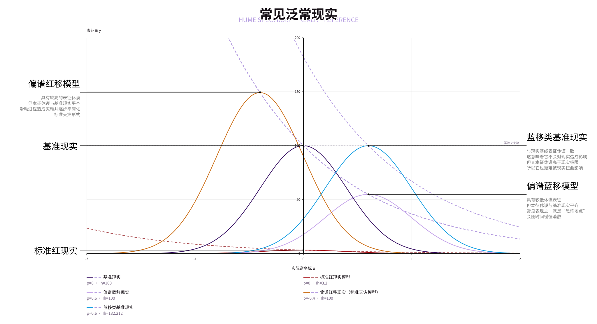
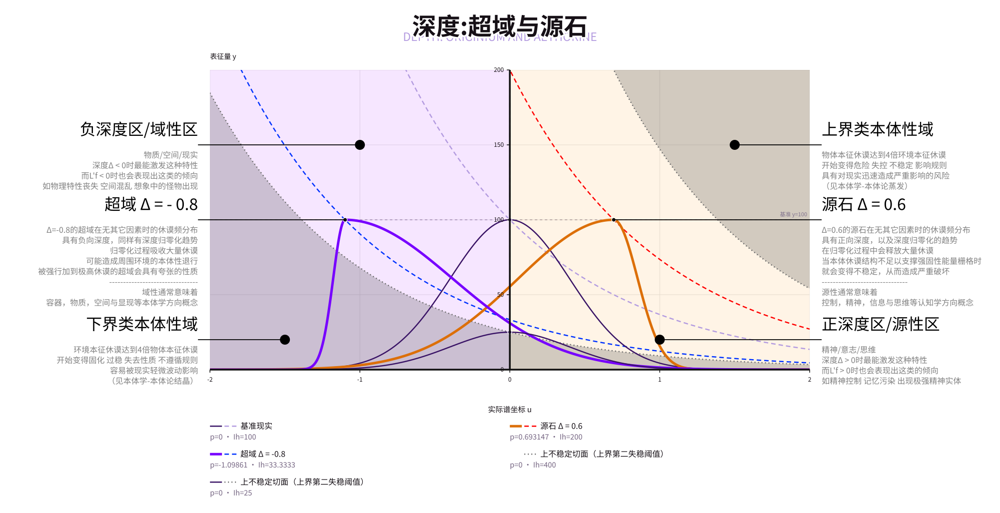

# 本体与休谟学概论

众所周知，休谟是衡量现实程度的数值。现行（或本设定/叙事域内）一100休谟作为基准现实强度。
高休谟可以控制低休谟的规则，而低休谟本身也会撕裂现实的规则。

这是某种平衡——至少对于它们双方而言，但我们，作为夹在中间的实体，似乎就不这么好运了：

- 高休谟环境会导致规则固化。对于无意志环境，量子力学等随机性现实特性会无限收敛向确定性，在高现实下移动，交互甚至感知都会被否决。
  至于意志实体，如果它的休谟足够高，我们甚至没有机会看到它们，而它们将我们的现实抹除则轻而易举。
- 低休谟环境会导致规则的崩溃。物理条件不再适用，空间，时间与物质变得混乱无序，直到最后将我们本身消融在其中。

这听起来可不太妙，不是吗？目前的理论体系认为，“现实”这一概念本身就不是稳定的，它能被影响，修改，并呈现出“某人”想要的样子。
但这就涉及到[`超形上学`的一些理念]()了，与我们的主题关联不大，因此不多赘述。
不过，的确，休谟学/现实学/本体学算是和超形上学，或者说叙事学交叉度很高的概念。

无论如何，让我们说回现实的休谟的问题吧。

传统休谟学将`休谟指数 Ih`描述为一个一维量，用于表述某点的现实程度，高休谟可以影响低休谟现实。

在源域性体系下，休谟会被展开为一个特殊的形式。这一形式可以统一的描述源石/超域/常规异常的特性，且能用于解释某些休谟表观正常的异常现象。
对于这套特殊的休谟描述体系，暂命名`拓扑休谟学`，或`类场休谟学`。其具体名字不重要，因此下文与所有相关文本中对休谟的描述统一默认视为该体系。

为了推导这一特性，我们在此做出如下预先定义：

令波的归一化自然对数`休谟主频`存在：`Lf = ln(f/f0)`，即标准现实下`休谟主频`为0。

令休谟的归一化自然对数`休谟级量`存在：`Lh = ln(Ih/100)`，即标准现实下`休谟级量`为0，当指数趋向于0时级量趋向于负无穷。
作为参照，标准红现实(以`休谟指数`3.2计算，原文中的0.032疑似采用的是是归一化休谟指数标准)的`休谟级量`大约是-3.4。

`本征休谟`是指一个对象内所实际蕴含的休谟总量与其体积的比值，
而`表征休谟`指的是其在谱展开状态下的波峰处强度值，表现为外部仪器对其稳定状态下休谟测量的时间平均值。

其二者不一定相等，但对于大部分不涉及超域/源石/复杂现实控制的情况下，
这二者的值应当是相等的，被称为`常态现实`，具体内容[见下方`休谟谱模型`](#休谟谱模型)。

在这一基础上，我们主要将理论结构分为两部分：

- `休谟谱模型`：主要针对的`本征休谟`与`基准现实`相差值还算合理的情况，此时`表征休谟`的波动是影响异常性质的主要特质，
  该模型通过对相关结构进行公式化拟合来提供宏观角度对于较可控异常的定性，在表现推理及研究方向探索具有重大价值。
- `本体论模型`：主要针对休谟对于个体/微观现象的细粒度空间/时间表现，或`本征休谟`已严重偏离`基准现实`的情况；
  对于前者，通常是实验研究与工程工具设计方向的研究对象，后者则是针对极高风险的不常见异常的风险分析。
  由于相关数据总量较少且对常规的异常处理行动的规划指导意义较低，其发展相对缓慢。

对于二者的划分标准是：如果一个对象的休谟状态和环境休谟状态差异不大，那使用`休谟谱模型`；否则使用`本体论模型`。
二者存在一个过渡带，即4倍到8倍`休谟指数`差异（或1.39-2.08`休谟级量`差值）之间。

## 休谟谱模型

以`休谟主频`为x轴，`表征休谟指数`为y轴的坐标系，`休谟频谱`在图像上呈(类)正态分布。

给定五个核心量：

- `休谟主频`/波谱峰`Lf`: 休谟波谱的峰值位置，代表其最易发生共振的状态。通常而言，绝对值越大表示实现概念粒度越高；
  统计学显示，这一数值可能影响其表现出的内容的形式：正值代表意识/精神/存在，负值代表物质/空间/现实。
- `表征休谟指数`/强度`Yf`: 休谟波谱峰值的高度，代表其可以被观测到的休谟强度。
  与标准休谟指数定义相似，通常进一步改变异常向外表达的能力和强度。在休谟学模型范畴内，其也可以起到压制效果。
- *`本征休谟系数`/实际休谟`Ih`: 真实的休谟值，通常可以由其他值算出来。
  在不存在休谟聚失焦(`σ ≈ 0.4`)或深度偏移(`Δ = 0`)且位于常态现实(`Lf = 0`)时，其值与`Yf`相等。
  较低的值会使得异常的表现形式更容易被现实影响，而较高值则会导致异常更倾向于“主动”制造非自然的灾难。
  一个异常在长时间与空间跨度上最终影响表现倾向的最终定性标准，意志类影响的核心定性标准。
  此外，例如一个高`Ih`低`Yf`的对象就更可能很少对现实造成影响(表征)但自身更为稳定与超现实(本征)。
- `深度 Δ`: 源/域性偏移值，影响波谱峰方向，通常是源石/超域运作的副产物。同样，绝对值越大表示趋势/非现实化越强，
  正值代表意识/精神/存在（源性），负值代表物质/空间/现实（域性）。
- `变焦标准差`/正态分布标准差`σ`: 通常 $\sigma = \frac{1}{\sqrt{2\pi}} \approx 0.40$ 。与一些特殊状态的物质或特殊表现行为有关。

另在此给出对于现实状态的定义：

- `常态现实`: `Lf ≈ 0`，位于`Lf-Yf`图表纵轴上/附近，维度上的表现与常规理解中的休谟类似，高休谟影响现实，低休谟被现实影响。
- `基准现实`: `Lf ≈ 0, Yf ≈ 100`，位于`Lf-Yf`图表纵轴上y=100位置附近。最接近常规理解中的现实状态。
- `类基准现实`: `Yf ≈ 100`，位于`Lf-Yf`图表上y=100的水平轴线。休谟测量值显示在100左右，但可能仍然具有超自然特性，
  通常(相对)不怎么危险。
- `泛常现实`: `Δ ≈ 0`，即`无深度偏移`，且`σ ≈ 0.4`，即`无休谟聚焦/失焦`。
- `泛现实`: 还能用休谟谱模型表述的东西都能算`泛现实`，与之相对的是下面[使用`本体论模型`表述的对象](#本体论模型)，
  通常本征休谟高到足以忽略一切谱分量带来的影响。

其中`(Lf,Yf)`被称为顶点/**表征点**。

下面的内容存在一些理论推导部分，[结论可以直接看这里](#模型概括与图例)。

### 泛常现实

记峰位x值`Lf`，对应峰值`Yf`为对外表达的休谟强度。对于标准常态现实，表达为`Lf=0,Yf=100,Δ=0,σ=0.4`；
对于标准红现实，表达为`Lf=0,Yf<100,Δ=0,σ=0.4`。

暂不考虑`深度`(见下)因素，即`Δ=0`，可以根据`Lf` `Yf`绘制出`休谟频谱`分布曲线：

$$y(x) = Y_f \cdot \exp\left( -\frac{(x - L_f)^2}{2\sigma^2} \right),$$

其形状类似标准正态分布曲线，`Lf`决定水平偏移，`Yf`决定高度。

-----

对于`泛常现实`情况下，由于 $2\sigma^2 = \frac{1}{\pi}$ ，正态分布曲线对 x 轴的积分面积恰好等于其峰值高度 `Yf`：

$$\int_{-\infty}^{+\infty} y(x)\,dx = \int_{-\infty}^{+\infty} Y_f \exp\left(-\frac{(x - L_f)^2}{2\sigma^2}\right) dx = \sqrt{2\pi}\sigma \cdot Y_f = Y_f$$

而对于任意波频位置 `Lf`，由 `Lf = ln(f/f0)` 不难推出其相对基准现实的频率倍率为 `f/f0 = e^Lf`
。将上述积分乘以频率倍率 $e^{L_f}$，即可根据上述值推出`本征休谟指数` `Ih`：

$$I_h = e^{L_f} \int_{-\infty}^{+\infty} y(x)\,dx = Y_f \cdot e^{L_f}$$

由此可知，当 `Lf = 0` 时，$e^0 = 1$，使得 `Yf` 在 `Lf = 0` 时恰好等于 `Ih`，即**在`常态现实`下，`本征与表征休谟指数`相等**。

基于这一定义方法，在 `Ih` 不变时，存在当 `Lf != 0` 时向 `Lf = 0` 自然滑动时的过`表征点`路径公式：

$$Y(L_f) = I_h \cdot e^{-L_f}$$

其在图像上表现为一个单调下降，向下弯折的弧线。

-----

对于任意`Lf ≠ 0`，其会表现为趋向标准现实化，具有休谟增高/减小的趋势，并在恰当条件下沿所在`Ih`轨道移动。

对应到现实中：

- `休谟主频 Lf`滑动时，当`Lf>0`，其倾向于影响精神/意志/思维；而`Lf<0`时则倾向于展示物质/空间/现实，但都常表现为异常；
- `表征休谟强度 Yf` < 100时，其更可能被现实影响；而高于100时则倾向于改变现实。

由对`休谟主频`与`休谟级量`的算法不难看出，在`Yf`不变时二者呈线性关系，
1.4的`Lf`就能带来高达406的`本征休谟`，已经触及到了`本体学模型`的过渡界限。

因此，通常`休谟主频Lf`的滑动通常不会很大，且较大的滑动通常伴随着`Yf`的同步滑动。

如图，展示了几种常见(存疑)`泛常现实`对应的图像：

### 深度偏移

存在深度偏移量 `Δ` ∈ [-1, 1]，用于描述波谱在源/域性作用下的不对称偏斜程度。
在几何上，`Δ`将波谱峰`Lf`两侧的标准差分别改变为左侧 $\sigma_L = \sigma(1 + \Delta)$
与右侧 $\sigma_R = \sigma(1 - \Delta)$，对应的“类正态分布”（双半宽偏正态分布）曲线公式为：

$$y(x) = Y_f \cdot \exp\left( -\frac{(x - L_f)^2}{2\sigma^2 \big[1 - \Delta \cdot sgn(x - L_f)\big]^2} \right)$$

（其中符号函数`sgn(x - L_f)`在`x > Lf`时取+1，在`x < Lf`时取-1，相等时取0）

对上述曲线左右两半分别积分可知，左侧展宽增加的面积与右侧收窄减少的面积恰好抵消：

$$\int_{-\infty}^{+\infty} y(x)\,dx = \frac{1}{2}(1 + \Delta)Y_f + \frac{1}{2}(1 - \Delta)Y_f = Y_f$$

因此，**`Δ` 的变化严格不会改变对 x 轴的积分值（即表征休谟强度 `Yf` 保持不变），仅使分布曲线变得不对称**。

基于此，不难推出此时的等效峰值和曲线表达式：

$$L'_f = L_f + arctanh(\Delta) = L_f + \frac{1}{2}\ln\left(\frac{1 + \Delta}{1 - \Delta}\right)$$

$$y(x) = Y_f \cdot \exp\left( -\frac{(x - L'_f)^2}{2\sigma^2 \big[1 - \Delta \cdot sgn(x - L'_f)\big]^2} \right)$$

当 $\Delta \to \pm 1$ 时， ${L_f}(\Delta) \to \pm \infty$。将上式代入本征休谟公式 $I_h = Y_f \cdot e^{L_f}$
，对数与指数直接抵消，可得该深度下的
`本征休谟指数`为：

$$I_h = Y_f \cdot e^{L'_f} = Y_f \cdot e^{L_f} \cdot e^{\frac{1}{2}\ln\left(\frac{1 + \Delta}{1 - \Delta}\right)} = Y_f \cdot e^{L_f} \cdot \sqrt{\frac{1 + \Delta}{1 - \Delta}}$$

因此，源性（正深度，`Δ > 0`）会表现为波谱右偏（左缓右陡，且峰位 `L'f > 0`，蕴含高本征休谟 `Ih > 100`）；域性（负深度，`Δ < 0`
）会表现为波谱左偏（左陡右缓，且峰位 `L'f < 0`，蕴含低本征休谟 `Ih < 100`）。

所有深度移动的过程都伴随着“读写”双向同时作用，所处位置决定了对应的主作用的强度，副作用强度与主作用强度呈负相关。
由于影响实际表现的因素极多，在此只做一般条件下的定性分析。

由于深度天然有向0滑动的主倾向，以及现实实体向反方向滑动的副倾向，实际稳定存在的源石/超域体通常会逐步向`Δ=0`滑动退化。

这里有必要初步介绍一下源石与超域的深度运作机制，[详细内容请见`源石结构学`章节]()与[`超域`章节](超域物理学.md)。

#### 源石（正深度 `Δ > 0`，高本征休谟态）

源石并非内化宇宙本体，而是在基准现实中开辟的“信息缓存载体”与“读写端口”。
读通道性质源于其内部`左旋φ子对`与正深度偏移（`Δ > 0`），这种偏移在现实与内化宇宙之间构筑了陡峭的拓扑势能差，使得源石具备读取现实信息并向内化宇宙发送的底层倾向。

例如对于某块 $\Delta \approx +0.8,\ Y_f = 100$ 的标准源石，其频率倍率为 $\sqrt{\frac{1+0.8}{1-0.8}} = 3$
，对应本征休谟高达 $I_h = 300$。

源石在向`Δ -> 0`滑动的过程中，从现实“读取”信息，并将其缓存在自身的源胞/晶格结构中，等待填充后向内化宇宙刷写归档。
归档过程中将同步释放出原本储存在正深度中的高额本征休谟差（如由 $I_h = 300$ 向 $100$ 回落），引发向现实输出物质的“写入”副作用，这二者就分别代表了源石的
`Δ滑动`与结构增生。

源石向内化宇宙归档信息的传输速度与其`Δ绝对值`呈正相关。当外部信息不断被读入源石并触发信息上传时，`Δ滑动`将会加剧，进一步引发传输速度下降。
这构成了一个自锁闭环：信息刷新 -> 深度偏移减小 -> 读写管道变窄 -> 信息堵塞。此时源石可能通过释放的休谟差来增生自己以增加总管道带宽，
若休谟差不足则会通过进一步`Δ滑动`来提供。

值得一提的是，源石的正深度倾向只是其常态下的特性，也存在反相负深度的源石(`类域源石`)。
负深度的源石由于主副倾向相反、需从外界倒吸本征休谟维持等原因不常见，只能通过特殊方法构造，用于特殊用途。

这种深度偏移的水平移动直接决定了源石的读写特性：

- 对于源石来说，**主动左移**（`Δ` 减小，峰位 `L'f` 沿 `Yf = 100` 水平线向 `0` 回退）是**读过程**，即周围物质的信息被读入源石内化宇宙；
  由于 `L'f` 左移时其对应的本征休谟当量 $I_h = Y_f \cdot e^{L'_f}$ 下降，**释放出的高额休谟差额**会同步引发 **“写”副作用
  **，即将物质带入现实，表现为源石晶体增生（源石化）；
- 反之，向右移动（向更高的正深度偏移）为**写过程**，但大部分源石通常自身不会主动发生写行为，一切自发读写均伴随上述反冲。
- 当 `Δ` 归零时，源石将因失去深度偏移而失活（退化为 $I_h = 100, \Delta = 0$ 的失活源石）。

这种平移不难看出副作用：虽然`Yf`不变，但若短时间内`Δ`剧烈左移归零，巨量本征休谟`Ih`
来不及通过缓慢结晶卸荷，就会触发源石的过休谟自失衡，导致一系列灾难性后果，例如感染者的粉尘爆炸(`急性粉尘化感染衰竭`)。
[见`异常学-分区图示-源石物质`章节](异常学.md#休谟-深度-特性表现分区示意图)。

#### 超域（负深度 `Δ < 0`，低本征休谟态）

与源石相反，超域物质（如`超域凝集源质`与`超域流质`）处于负深度偏移状态（`Δ < 0`），其本质是剥离了一切信息与结构定义的纯粹“质能与空间”。

由于 $\Delta \to -1$ 时频率倍率 $\sqrt{\frac{1+\Delta}{1-\Delta}} \to 0$，超域物质的`本征休谟Ih` 极低
（例如`超域凝集源质`内部本征休谟仅约 $0.007$，对应`休谟级量` $L_h \approx -9.51$，远低于标准红现实），必须在极低休谟环境中才能稳定存在。

当超域物质泄漏进入基准现实（ $I_h = 100, \Delta = 0$ ）时，其向 `Δ -> 0` 的**右移平衡过程**表现为与源石截然相反的机制：

- 由于超域物质自身处于极低本征休谟的“空白质能”状态，
  周围现实的高休谟场会携带着环境中的结构信息（`隐模因`）向超域物质内部剧烈**倒灌**；
- 在这一过程中，超域物质本身不具备源石的主动“读写”晶格，而是像空白画布一样被动接受周围现实信息的拓印，
  在边界处凭空析出与周围环境信息相似的怪异物质或空间结构，这一现象被称为**`泛信息投影`**；
- 随着外部休谟与信息的不断灌入，其负深度 `Δ` 向 `0` 回升，`本征休谟 Ih` 随之上升，当内部休谟平衡越过阈值（$L_h > -9.23$）后，
  `超域凝集源质`便会整体退化为侵蚀性较低的`超域流质`（由`双右旋φ子对`/域子对构成）。

### 休谟变焦

在常态现实中，休谟波谱的标准差维持在基准值 $\sigma_0 = \frac{1}{\sqrt{2\pi}} \approx 0.40$
（此时 $\sqrt{2\pi}\sigma_0 = 1$）。
当波谱受源石技艺、异常效应或人工装置影响而发生展宽或收窄（即 $\sigma \neq \sigma_0$）时，这一现象被称为**休谟变焦**。

由于标准差 $\sigma$ 的改变直接缩放了波谱的横向宽度，但不会改变其峰位与对称性，此时分布曲线对 x 轴的积分面积变为：

$$\int_{-\infty}^{+\infty} y(x)\,dx = \sqrt{2\pi}\sigma \cdot Y_f = \left(\frac{\sigma}{\sigma_0}\right) Y_f$$

由此可见，在`本征休谟指数` `Ih` 与峰位不变的前提下，`表征休谟指数` `Yf` 与聚焦量 $\sigma$
呈严格的反比关系（记 $\sigma = \sigma_0$ 时的常时表征休谟为 $Y_{f0} = I_h \cdot e^{-L'_f}$）：

$$Y_f(\sigma) = \frac{1}{\sqrt{2\pi}\sigma} \cdot I_h \cdot e^{-L'_f} = \left(\frac{\sigma_0}{\sigma}\right) \cdot Y_{f0}$$

这一反比关系在现实中对应两种极端状态（详细应用与防御机制见[`异常学`章节](异常学.md)）：

- **局部过焦 / 现实成像 `σ -> 0`**：
  将有限的本征休谟 `Ih` 高度压缩在极窄的特定频段上，可使表征休谟 $Y_f \to +\infty$，从而以较小的实际休谟消耗在局部瞬间压制并扭曲现实（常见于源石技艺施放瞬间）。
- **局部失焦 / 现实放逐 `σ -> +∞`**：
  对象的休谟频谱无限拉宽稀释，可使表征休谟 $Y_f \to 0$，使其在不改变本征休谟 `Ih` 的前提下被常态现实完全压制而从表观现实中隐没
  （常用于异常的`失焦收容`）。

> 在 `(0, +∞)` 的变焦定义域上，基准标准差 `σ0 ≈ 0.40` 是无变焦效应的平衡中点（`σ < σ0` 为聚焦，`σ > σ0` 为失焦，`σ = σ0`
> 时无作用）。
> 因此，当原有变焦标准差为 `σo` 的背景环境与机器在距离中心 `x` 处产生的独立变焦场 `σm(x)` 叠加时，二者的相对变焦倍率相乘，即：
>
> $$\sigma(x) = \frac{\sigma_o \cdot \sigma_m(x)}{\sigma_0}$$
>
> 易知：当机器关闭或处于无穷远处（`σm(x) = σ0`）时有 `σ(x) = σo`；
> 在常规基准现实（`σo = σ0`）下，则有 `σ(x) = σm(x)`。

具体到源石方面的应用，源石技艺通常依靠的就是对使用者本身的休谟聚焦后`表征休谟`的回落过程快速释放出大量现实扭曲；
或是通过`表征休谟`放大使用者本身对现实的扭曲能力（对于本身就属于现实扭曲者，即`本征休谟`>环境的人而言）。

不论力量来源于扭曲释放还是维系聚焦状态，这都会对施术者本身造成较大负荷甚至严重副作用，因此不应用外部工具的法术极难长时间维系。
通常强大的源石术士仍是被源石感染的现实扭曲者，且多会使用各种异常物件辅助。

以及，在乌萨斯矿脉枯竭事件中出现的物质“奥卡”就是一种`σ -> +∞, Ih = 100, Yf -> 0`的特殊异常体，其表征休谟测量值永远是0。

其`Ih = 100`的性质使其在常态下不易与现实发生休谟交换，而`σ -> +∞`使其`Yf -> 0`，在表现上被现实完全压制。
同时，其内部巨量的高活性`解离φ子`使得其会不断尝试和其它外部`φ子`结合，从而将整个源石结构拉入失焦态并破坏，同化成奥卡。

这一过程可能伴随着释能与局部休谟升高，此时的奥卡具有一定的侵蚀性，反应区域出现燃烧，放电，闪光与物质生成等均属于正常现象。
在局部休谟重新达到平衡后，奥卡将恢复惰性态。

[具体有关奥卡的内容请跳转到`源石物理学-奥卡`部分。]()

失焦行为通常需要大量能量支撑或可能带来较大的副作用，且针对性防御手段众多。
因此，这被视为一种“对策性技巧”而非异常的常规使用方法。

另外，还有一种特殊的聚焦情况，建立在异常的不稳定失焦基础上——与模因的一支有关。目的的理论结构中，最简单的描述是：
模因聚焦通常在实体认知到某件事物时触发，将广泛存在于本体论背景中的异常在这个位置进行聚焦到近标准水平，异常就会顺着这条路径涌出，造成危害。

相关内容[请参见`模因学概论：知识，记忆，意志`篇章]()或[`异常学-现象与收容-模因触发式回焦`部分](异常学.md#模因触发式回焦)。

-----

需要注意的是：判断一个聚焦/失焦的特性可以与周围的环境进行对比，但如果环境本身出现大范围`σ`偏移呢？

尽管 $\sigma_0 \approx 0.40$ 通常被认为是现实常态下的标准，但“现实常态”本身也并非绝对稳定。

异常/时间线/研究均表明，这种状态其实是“被在现实基础上维持的”，
这意味着如果真的发生了严重事故，我们仍有可能得到一个`σ`极高或极低的地区，甚至宇宙。

相关内容[`异常学-现象与收容-广域失焦`部分](异常学.md#广域失焦失焦性红现实-σe----)。

### 公式总结

综合上述`休谟主频 Lf`、`表征休谟指数 Yf`、`深度偏移 Δ ∈ (-1,1)` 与`聚焦量 σ`
（基准值 $\sigma_0 = \frac{1}{\sqrt{2\pi}} \approx 0.40$）四个核心参量，任一休谟状态下的完整数学表达汇总如下：

1. **等效波谱峰位公式**（基础主频 `Lf` 叠加深度 `Δ` 的水平推动）：

$$
L'_f = L_f + arctanh(\Delta) = L_f + \frac{1}{2}\ln\left(\frac{1 + \Delta}{1 - \Delta}\right)
$$

2. **`休谟频谱`分布曲线公式**（偏正态分布曲线，`σ = 0.4`，`Δ = 0`且`Lf = 0`时`Yf = Ih`）：

$$
y(x) = Y_f \cdot \exp\left( -\frac{(x - L'_f)^2}{2\sigma^2 \big[1 - \Delta \cdot sgn(x - L'_f)\big]^2} \right)
$$

（若将 $L'_f$ 完全展开写成单行，则为：）

$$
y(x) = Y_f \cdot \exp\left( -\frac{\left[x - L_f - \frac{1}{2}\ln\left(\frac{1 + \Delta}{1 - \Delta}\right)\right]^2}{2\sigma^2 \left[1 - \Delta \cdot sgn\left(x - L_f - \frac{1}{2}\ln\left(\frac{1 + \Delta}{1 - \Delta}\right)\right)\right]^2} \right)
$$

3. **波谱积分面积与`本征休谟指数 Ih` 通用公式**：

$$
I_h = e^{L^\prime_f} \int_{-\infty}^{+\infty} y(x)\, dx = \sqrt{2\pi}\sigma \cdot Y_f \cdot e^{L_f} \cdot \sqrt{\frac{1 + \Delta}{1 - \Delta}} = \left(\frac{\sigma}{\sigma_0}\right) \cdot Y_f \cdot e^{L_f} \cdot \sqrt{\frac{1 + \Delta}{1 - \Delta}}
$$

4. **等本征滑动路径公式**：

$$
Y_f(L_f, \Delta, \sigma) = \frac{I_h}{\sqrt{2\pi}\sigma} \cdot e^{-L'_f} = \left(\frac{\sigma_0}{\sigma}\right) \cdot I_h \cdot e^{-L_f} \cdot \sqrt{\frac{1 - \Delta}{1 + \Delta}}
$$

### 梯度流动

除了上述情况外，空间中的休谟本身也会流动并趋于平衡。这种情况就很复杂了，会被大量现实因素干扰。

已知的信息是，实体通常对休谟具有特殊的影响能力，例如现实扭曲者就存在逆梯度休谟聚焦（一说空间性休谟偏焦）；
常态下大部分物质对休谟的传递能力只有少量差异，但对于（被）现实扭曲者，源石，超域，异常体等，都具有独特而难以解释的传导能力差异；
特殊设计的装置或结构可以影响休谟的传递，大多数要用到含`φ子`的特殊物质或者其它超现实异常物品/技术。

由于相关影响因素过多且对休谟自体理论的实用学研究能解决几乎所有问题，该方向上的理论并没有取得过多发展：
对近现实而言，它的影响能被自体研究的结果有效解决；对超现实来讲，休谟结构本身都算得上是易被影响之物之一。

因此，在此不过多赘述，只需知道：**大多数情况下，休谟具有从高`Ih`区域向低`Ih`区域滑动的倾向，且较为缓慢**。

关于与此相关的一些特性，[请参考下方`本体论模型`部分](#本体论模型)。

另外，对于这种现象的描述词语很多，且通常不具有官方标准。其含义几乎完全相同，所以看到时知道是同一个意思即可：
`梯度流动` `梯度扩散` `休谟扩散平衡` `休谟扩散` `休谟平衡` `休谟流动`

### 模型概括与图例

总而言之，对于这一模型，各个参数意味着：

- `Lf-休谟主频`: 通常为0即“常态现实”，偏移值代表对休谟的压缩，正值降低`Yf`负值则增加`Yf`，
  具有自发滑向0的倾向。统计结果上，负值异常易表现为物质化，而正值实体易表现为精神化。
- `Yf-表征休谟指数`: 通常为100即“(类)基准现实”，数值代表可以被仪器观测的休谟状态数值。
  近似等效可以被观测到的物质休谟强度（不考虑聚焦情况下），影响异常物体对外表现异常性质的活性，本质属于对`本征休谟`表现特性的缩放。
- `Δ-深度`: 源/域性偏移值，影响波谱峰方向，通常是源石/超域运作的副产物与动力源。
  同样，绝对值越大表示趋势/非现实化越强，正值代表意识/精神/存在（源性），负值代表物质/空间/现实（域性）。
- `σ-变焦标准差`: 通常$\sigma = \approx 0.40$。聚焦是利用其它资源将休谟谱强行合拢并表现出更高`Hf`的重要方法，但成本昂贵。
  源石技艺的聚焦造成强大效果的能力来源于`表征休谟`滑动时的扭曲释放，而非数值本身，因此不应用外部工具的法术极难长时间维系。
- `Ih-本征休谟系数`: 真实的休谟值，通常可以由其他值算出来，决定异常的侵染与现实压制是否发生的定性决断量。
  较低的值会使得异常的表现形式易被现实影响/与现实相似，较高值会导致异常可能表现出一些非实体层面的影响或在现实中从未见过的场景。
  也是意志体中实际决定“影响”与“被影响”关系的量，高`本征休谟`者影响低`本征休谟`者。

> 需要补充的一点：意志影响
>
> 通常所说的意志影响，即高休谟对象的意志目的影响低休谟对象的行为逻辑主要源于`本征休谟`的浓度差值。
>
> `表征休谟`的浓度差主要影响的异常体对外表达能力的强度与活性，而通过聚焦（）

## 本体论模型

本体论模型主要用于两方面：

- 解释一些针对具体异常，特别是实体或类源石/超域体的特性与休谟结构问题，其目前的发展不够完善，因此缺少定量比较和分析的手段，
  但对于前沿休谟工具的设计拥有较高价值，推测在未来存在加速发展的趋势。
- 解释一些`本征休谟`严重偏离基准现实（或者环境）情况下对象发生的变化，在收容维稳方面价值不菲，也能帮助我们更好理解一些超物质存在的异常。
  从这一角度而言，这部分其实已经带有了一些叙事学角度特性。

在本体学范围内我们通常不考虑`深度Δ`和`聚焦σ`情况，其二者会被超强的现实扭曲会迅速抹平这两个概念的影响并对构造带来巨大的难度。

`谱峰偏移Lf`和`表征休谟Yf`重要性也不高，只是前者通常不那么容易被影响从而可能影响后者，而后者与`第二失稳阈值`有关。
除这一特殊考量外，二者也能被忽视。

不过，虽然说范围内不考虑，但通过`深度`与`聚焦`来构造受`本体论模型`影响的物体确实是一个不错的方法。
以及，确实存在一些在数值上满足`本体论模型`特性标准的物体不表现出本体论特质，[例如`绿/蓝域晶源石`这种东西]()。

### 现实扭曲者/绿体

具体到单块源石/超域质/现实扭曲者/被现实扭曲者，其休谟表现和上述模型中提到的不尽相同。以现实扭曲者为例，这需要分为三种情况：

- 频率采样：从频率角度而言，虽然大部分情况它们的`休谟主频`
  都会落在同一位置，但对于完整休谟图像，其只在长时间测量后具有统计学意义上的(类)正态分布图像特质。
- 时间采样：对同一相对位置而言，在时间轴上，其采样到的`本征休谟`会小幅跳动，而`表征休谟`会大幅跳动。

  值得注意的是，统计上发现，对于目标准备发动袭击时，通常存在：
  体内某点`表征休谟`上升，`变焦标准差`下降，`本征休谟`略微下降；体外点无明显聚焦现象，但`表征/本征休谟`统计学上都出现了上升倾向。
- 空间采样：通常而言，与常规描述一样，标准采样方式会得到一个实体`表征休谟`高周围环境`表征休谟`低的结构，而`本征休谟`
  的差值则相对没那么明显。同样不断跳动。

  一种猜测认为这就是一种聚焦的行为方式，通过让周围环境同时右偏谱与`散焦`，为核心部分贡献左偏谱与`聚焦`的反冲分量。二者的因果关系也可能相反。
  如果这种猜测正确，考虑到聚焦和偏谱本身稳定性的问题，现实扭曲者应该会有一个扭曲到的`表征休谟`上限，而且通常不会很高。

  如果这种特性能被在其它异常上发现，那很可能有很多异常其实并没有我们所担心的具有极高`本征休谟`，只是`聚焦`强化了它们的能力。
  而不论是异常的`聚焦`能力相比直接降低`本征休谟`难度和成本低很多，还是研究异常的`聚焦`能力能为我们带来更高效的休谟调节方案，这都是好消息。

因此，制式休谟计数器在针对现实扭曲者实体的行动时休谟探测通常都会得到一个急剧跳跃的混沌数值。
在此情况下，需要考虑开启计数器的“动态波动性均值测量”模式，该模式会根据采样场内休谟波动差值进行时间平均值求解，
从而得到较为可靠的`表征休谟`数值。

相应的，其它上面列出的元素也进行过类似测试。源石和超域对周围的跳动休谟场呈现出某种连续化与类周期性特质，且相对平缓慢速。

噢，被现实扭曲者是个特例——它的休谟场跳动性真的很低。不要笑。

### 切变边界

休谟场在常态空间中是连续的，但对于异常物边界，其可能存在不连续的切变，被称为休谟`切变边界`。

这一边界通常被认为是影响休谟空间扩散的重要原因之一，存在这种边界的异常与现实的休谟流动速度低于连续场。

大部分情况下，这一边界包裹在休谟异常物体周围，在空间上连续的，通常与其实体边界吻合。
但也存在一些特例，例如确实休谟很高但却与环境休谟场连续的异常；
也存在一些被特殊构造的切变边界甚至单向切变边界，被视为是先进现实稳定装置的研究方向之一。

其可以被视为异常的“内外”的分界，通常说的对物品的表征休谟的测量指的就是该表面表现出的休谟强度的平均值。

除非另行说明，源石/超域/`连续态智能实体`都有切变边界，即便有时候它和现实完全连在一起导致测量值上是平滑的。
`奥卡`就属于一个特例，它真的没有切变边界，所以能快速将吞噬的源石的休谟平衡到环境中。
当然这也使它不太属于本体论讨论范畴，它本身的本征休谟很接近，或者说容易被平衡到100。

在一些与环境休谟差较大的含`切变边界`的物质的测试中发现了一个有趣现象，例如存在一个物体的`本征休谟`远高于周围的环境：

假定一轴代表空间位置，该轴原点代表切变边界位置，左侧代表环境（低）右侧代表高休谟物体（高），竖直轴代表`本征休谟`强度：
函数会在从左侧接近零点时出现一个下切，而从右侧接近时出现一个上切，如图：

[//TODO]

这一现象在差值较低时几乎没有被观测到，但主流研究仍倾向于认为这是一种固有的填充倾向被边界意外截断导致的。
在较低差值状态下，可能被其它因素压制而无法被精确观测。

另外，还是我们的被现实扭曲者。

其也具有这种边界结构，外界面边界存在下切，边界切向与梯度方向一致。
这就像是一个漏斗，使得现实倾向于流入其中——与现实扭曲者不同，这些现实真能流进去。这可能解释了为什么被现实扭曲者会更容易受到环境的影响。

### 宏观本体论模型核心表述

当存在休谟切变边界的对象内外休谟差过大时，它可能会发生一系列异常，例如结构叠加，闪烁，物理属性失常。

当差异变得更大后，其将直接消失并无法观测。从性质变化到消失于现实的切换行为就被称为`本体论坠出`。

与之相对，的确也存在对象从外现实域返回现实的情况，这被称为`本体论坠入`。

坠出的发生条件极为苛刻，其本身可以被量化。

- 切面两侧的休谟比/归一对数化休谟差大于4时会开始发生失稳，此值被称为`第一失稳阈值`。
- 该值大于8且表征休谟比大于4时后完全去现实化，此值被称为`第二失稳阈值`。

`失稳阈值` `本体学失稳` `本体学坠出/入`都可以在添加`上界/下界`来分别表示对象在低休谟/高休谟下的情况，例如：

- `上界第二失稳阈值`表示对象休谟条件在远高于环境休谟时发生`上界本体论坠出`所需的条件，
  即对象`本征休谟`大于8倍环境`本征休谟`且对象`表征休谟`大于4倍环境`本征休谟`；
- `下界本体学失稳`表示对象位于`下界第一失稳阈值`与`下界第二失稳阈值`之间，
  即对象`本征休谟`小于环境`本征休谟`的1/4，但大于环境`本征休谟`的1/8或环境`表征休谟`的1/4。

以`基准现实 Ih = Yf = 100`计算：

- `上界第二失稳阈值` = 800Hm
- `上界第一失稳阈值` = 400Hm
- `下界第一失稳阈值` = 25Hm
- `下界第二失稳阈值` = 12.5Hm

用图片表示的话，大概长这样：

[//TODO]

基于这些属性，我们可以定义一些与本体论有关的专有名词的含义。
事实上这些名词很少用到，因为它们只会出现在极端的高低休谟个体上：

- `泛现实`: 上面休谟谱模型已经提及过这一概念。所有位于`上下界第二失稳阈值`之内状态的对象都属于`泛现实`。
  与之相对，位于其之外的部分都能被称为`外现实`。
- `本体论超实体/超实体/超对象/外实体/外对象`: 描述方法很多，但都是同一个意思。
  对位于`下界第二失稳阈值`之下或`上界第二失稳阈值`之上的对象的描述，通常不存在与传统理解的现实中。
  不考虑其如果发生坠入可能导致的物理性冲击，它们大部分情况下要不极其危险（假如你遵守一定规则可能不会有事）要不完全安全，
  而更多情况下双方互不“知晓”对方的“存在”。
- `失稳阈值`: 对象发生失稳/坠出入的休谟状态边界，上面已经说过了。
- `上界`: 对象休谟状态**远高于**环境时状态/界限修饰词。
- `下界`: 对象休谟状态**远低于**环境时状态/界限修饰词。

对于对象/有界结构而言：

- `本体论坠入`: 过程，对象从`泛现实`外进入`泛现实`内，
  或表述为对象向下穿越`上界第二失稳阈值`或向上穿越`上界第二失稳阈值`，表现为异常体可见化。
- `本体论坠出`: 过程，与`本体论坠入`正好相反，从`泛现实`内进入`泛现实`外，表述与表现略。
- `本体论失稳`: 状态，对象位于单界一二`失稳阈值`内，表现为状态异常，结构叠加，闪烁，物理属性失常，过度固化，交互特性丧失等。
  这种现象叫做`因果相干性(causal coherence)丧失`。上下失稳通常表现不完全相同，上失稳通常更剧烈危险。

  *也可以表述为“对象位于`上界第一失稳阈值`与`上界第二失稳阈值`范围内或`下界第一失稳阈值`与`下界第二失稳阈值`范围内”。*
- `本体论蒸发`: 过程或状态，请根据语境自行判别，对`本体论失稳`在上界状态下表现的专用描述。
- `本体论逃逸域`: 状态，对象发生`本体论上界坠出`后进入的状态，又叫`外蓝现实`。
- `本体论结晶(ontological crystallization)`: 过程或状态，对`本体论失稳`在下界状态下表现的专用描述。
- `本体论弥散域`: 状态，对象发生`本体论下界坠出`后进入的状态，[又叫`外红现实`](异常学.md#现实衰竭休谟性红现实-ihe--100)。
- `本体论弥散背景(fond diffus ontologique)`: 严格表述是`Ih === 0`，此时休谟状态完全归零，理论上只能无限趋近不能到达。
  因此，在大部分实际案例讲解中指的是`Ih -> 0+`的极小邻域。请根据语境自行判断所指。

对于环境/无界区域（也就是说本质上你可以说一个有界结构的内部是无界区域）而言：

- `本体论真空`: 当一个环境休谟很低（真的很低）时，它会吸引周围的休谟不断涌入，这块低休谟环境就可以被称为`本体论真空`区域。
- `本体论虹吸`: 专门用来描述环境中的休谟被其它内容/对象抽干的过程。
- `本体论热点`: 与上面相对，一块不断向外释放休谟的高休谟区域。当然，相对于现实休谟更高的状态区域其实很难想象，什么叫“物理特性过量”？
- `本体论渗流(ontological effusion)`: 与上面相对，描述环境的休谟被其它内容/对象填充的过程。

### 本体论失稳与坠出/入

`本体学失稳`和之后的坠出/入过程阶段休谟探测工具就已经无法正常运作，因此目前暂没有对过程情况进行准确且合理测量的方案，
目前的猜测认为它的状态和上面提到的`现实扭曲者`的状态较为相似，但更为狂暴难控。

目前尚不清楚这种`超物体`具体的性质、所处位置、存在性、以及具体要如何将其拉回现实。

大部分`神性实体`/`叙事层逻辑与切入点`很可能都属于此类。

对于`下界坠出`，坠出体通常以某种类奇点态存在，存在空间上重新捕获并恢复的可能；而对于`上界坠出`，目前对象性质不明，目前暂未找到确定具体位置的方法。

一般认为，只有具有切变边界的对象才可能发生`本体论坠出/入`和其它本体论异常。
对于无边界对象，通常会成为一个被现实快速回填的塌陷点，无法稳定“消失”。

不过，一些异常也确实能做到这一点，例如见[`上界游记`篇章]()：
一次意外事故造成的`本体论渗流(ontological effusion)`(见下)导致整个被锚定站点被超现实化并消失。经过成员的努力，该站点最后重新在另一地点出现。
但无边界的空间结构在超现实中被不断蚀解，最终返回现实时整个空间结构的几乎已经完全混乱而破损。

### 进入外现实的实体

根据进入的是`下界外现实/本体论弥散域/红现实`还是`上界外现实/本体论逃逸域/蓝现实`，其表现特征不同。

对于`下界外现实`，其与`SCP-3001`比较相似，请参考[异常学-休谟性红现实](异常学.md#现实衰竭休谟性红现实-ihe--100)；

对于`上界外现实`，[`SCP-3999`](https://scp-wiki-cn.wikidot.com/scp-3999)
是其目前最符合要求的可读特性缩影，目前没有进一步的资料描述这种情况下真正发生了什么。

另外，不论是哪一侧的`外现实`都会使对象经历严重的自我解离痛苦，表现为感觉自己的身体被分散到各种事物之中，
共感世间的一切，完全的去中心化与思考短路，以及彻底的痛苦。
这一特性与[`SCP-2718`中的表述相似](https://scp-wiki-cn.wikidot.com/scp-2718)。

所以，不建议在没有准备的情况下进入`外现实`。目前我们对其还知之甚少，特别是`上界外现实`。